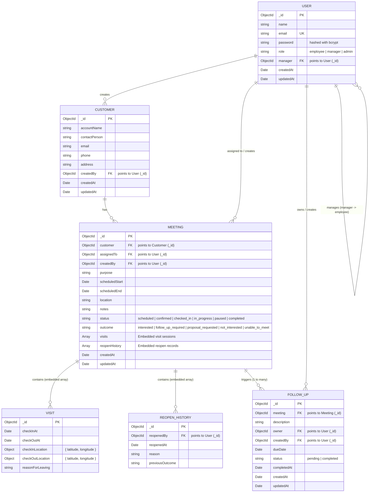

# SalesPilot Entity-Relationship (ER) Diagram & Data Model

SalesPilot uses MongoDB with Mongoose schemas. Below is the logical data model and entity relationships.

## Entity Relationship Overview

---

## Collections & Modeling Details

### 1. `users` Collection
- Represents system accounts with role-based access.
- Role values: `employee`, `manager`, `admin`.
- Self-referencing `manager` field links an employee to their direct manager.
- Indexed on `email` (unique).

### 2. `customers` Collection
- Holds client accounts and points of contact.
- Indexed on `accountName` for sorted listings.

### 3. `meetings` Collection
- Core lifecycle document containing scheduled intervals, current status, and outcome.
- **Embedded Visits Subdocuments (`visits`):**
  - Allows multiple visit sessions per meeting (e.g. initial check-in, temporary checkout, return check-in, and final completion).
  - Preserves check-in and checkout timestamps, location coordinates, and reasons for temporary departure.
- **Embedded Reopen History (`reopenHistory`):**
  - Tracks manager reopen actions, recording the manager ID, timestamp, explanation, and previous outcome.
- Indexed on `{ assignedTo: 1, scheduledStart: 1 }`.

### 4. `followups` Collection
- Action items generated from meetings with outcome `follow_up_required`.
- References the originating meeting and the assigned owner.
- Indexed on `{ owner: 1, status: 1, dueDate: 1 }` for team and user workload queries.
